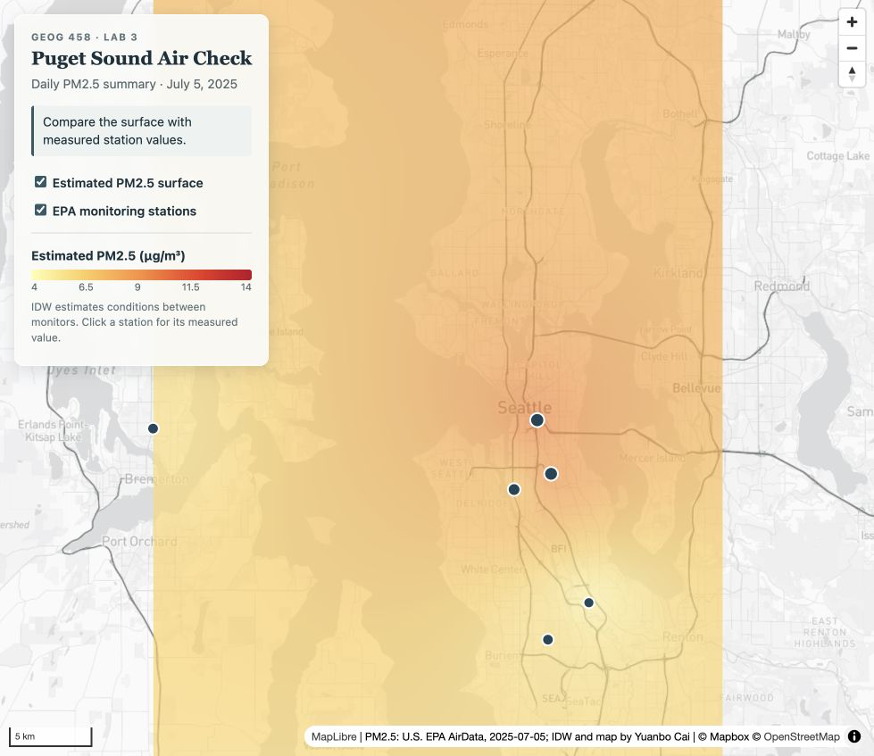
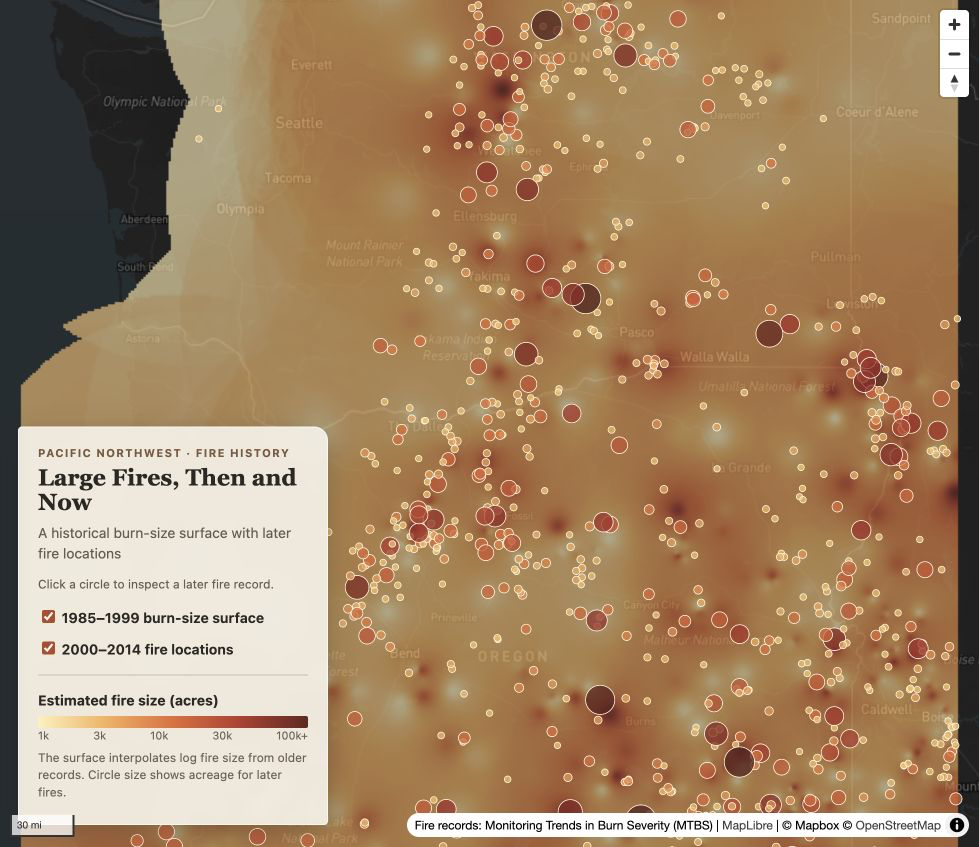

# GEOG 458 Lab 3

This folder contains two maps that combine a local Mapbox-derived basemap, a thematic raster tile layer, and interactive vector data.

## 1. Puget Sound PM2.5

The guided map shows daily PM2.5 conditions around Puget Sound on July 5, 2025. It is meant for someone who wants a quick regional comparison while still being able to check the measured value at an individual monitor.



- Study area: Tacoma to Marysville, including Seattle and Bremerton
- Observations: 11 U.S. EPA AirData monitoring sites
- Units: µg/m³, 24-hour block average
- Processing: the station points were projected to Web Mercator and interpolated with inverse distance weighting (power 2). The surface uses a 4–14 µg/m³ yellow-to-red ramp.
- Basemap: `mapbox://styles/doudou012819/cmvrqs6f6001a01sq1u8l51ox`
- Tile levels: 8–12, XYZ, 256 px PNG

The Studio style removes five commercial POI classes so the thematic layer has more room. Motorways and other major roads are darker than local roads; the same color rule is used on surface, bridge, and tunnel segments.

The raster surface is an estimate between monitors. The station popups report the measurements themselves, along with the date and station ID. Turning off the surface makes the difference between estimated and measured information easier to see.

## 2. Pacific Northwest fire history

The independent map looks at large fires in Washington, Oregon, and Idaho. It is designed for a regional planning or land-management audience interested in where large fires occurred and how the later record compares with the older pattern.



- Historical raster: 523 MTBS fire centroids from 1985–1999
- Interactive vector layer: 838 MTBS fire centroids from 2000–2014
- Attribute used: mapped burn boundary acreage (`BurnBndAc`)
- Processing: acreage was converted to log10 before IDW so a few very large fires would not dominate the surface. The raster estimates the broad spatial pattern of fire size; it is not a count of fires or a burn-probability model.
- Basemap: `mapbox://styles/doudou012819/cmvrqy6bu001b01sqhfijbz7l`
- Tile levels: 5–8, XYZ, 256 px PNG

The second Studio style starts from the classic Dark style. Water was shifted toward a muted blue-gray, land toward warm charcoal, and the major-road network was made slightly lighter than local roads. Warm fire colors stay visible without losing place and road context.

Clicking a recent-fire circle shows its incident name, ignition date, mapped acres, and incident type. Circle size and color also change with acreage.

## Sources

- PM2.5: U.S. EPA AirData, daily summary records for July 5, 2025. Details are in `data/pm25_source.json` and `data/pm25_data_notes.md`.
- Fire records: Monitoring Trends in Burn Severity (MTBS) fire occurrence centroids. The two downloaded periods were clipped to -125° to -116° longitude and 42° to 49° latitude.
- Basemaps: Mapbox and OpenStreetMap contributors.

## Folder structure

```text
lab3/
├── yuanbocai_lab3-1.html
├── yuanbocai_lab3-2.html
├── data/
│   ├── pm25_stations.geojson
│   ├── pm25_puget_sound_2025-07-05.csv
│   ├── wildfires_1985_1999_pnw.geojson
│   └── wildfires_2000_2014_pnw.geojson
└── assets/
    ├── mapbox-guided/
    ├── pm25-guided/
    ├── mapbox-independent/
    └── wildfire-history/
```

`build_tiles.sh` records the commands used to rebuild the two thematic tile sets and download the two published Mapbox styles. It expects the public token in the `MAPBOX_TOKEN` environment variable rather than storing the token in the repository.
